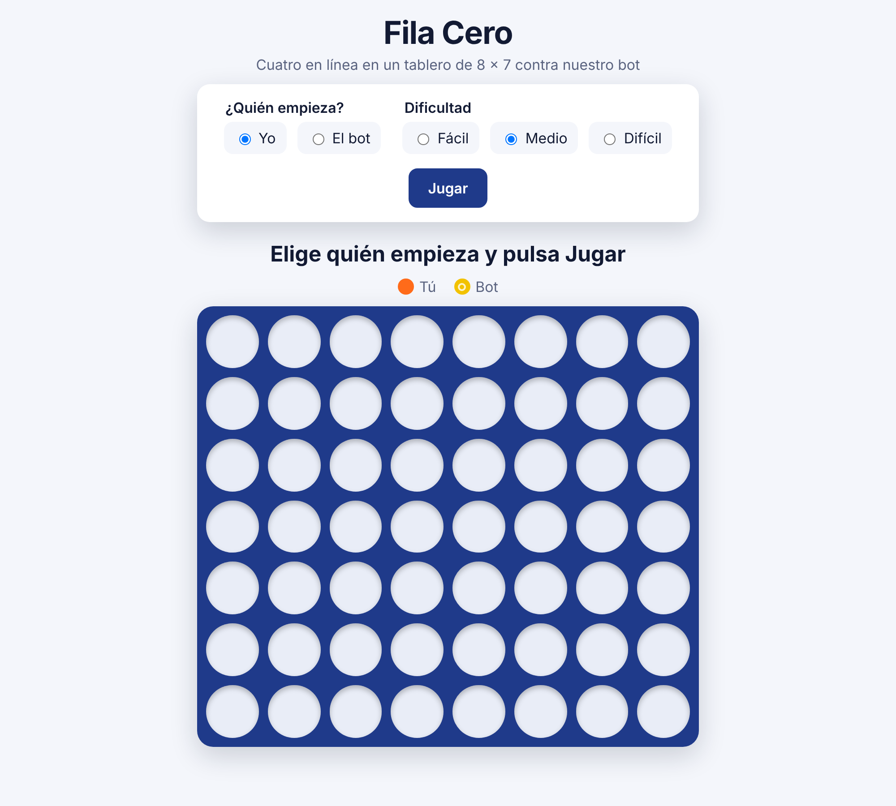
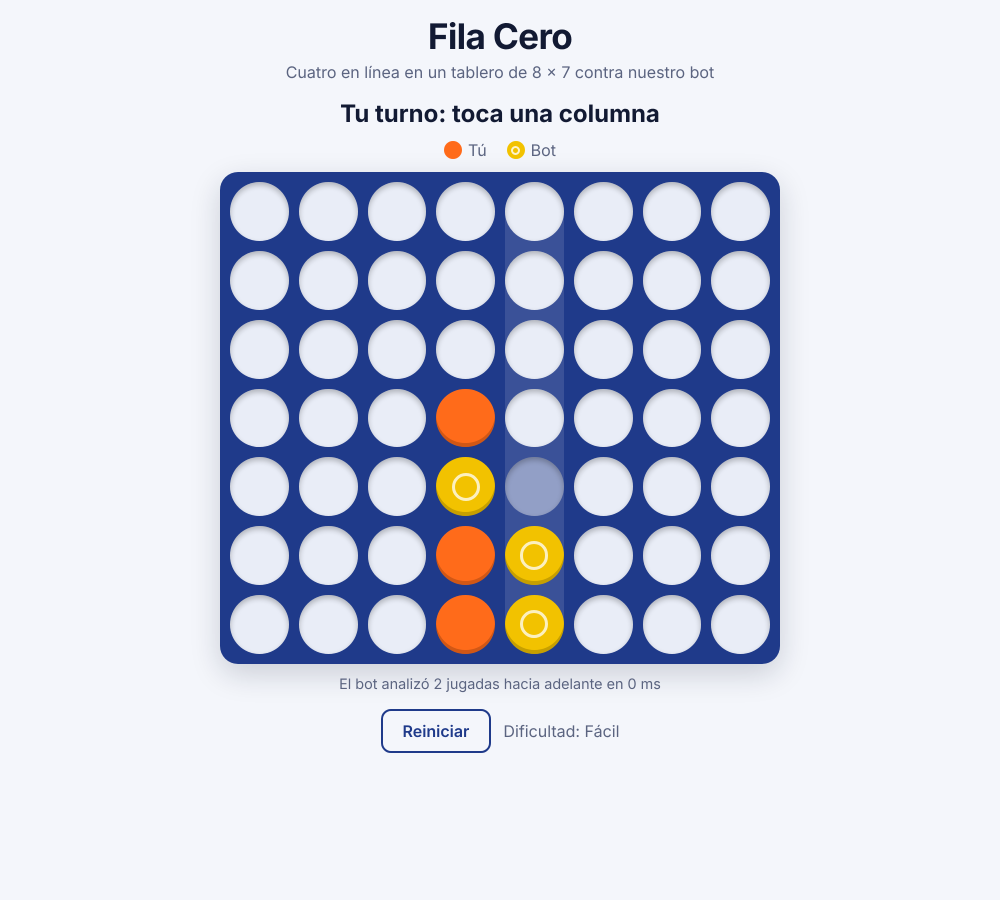
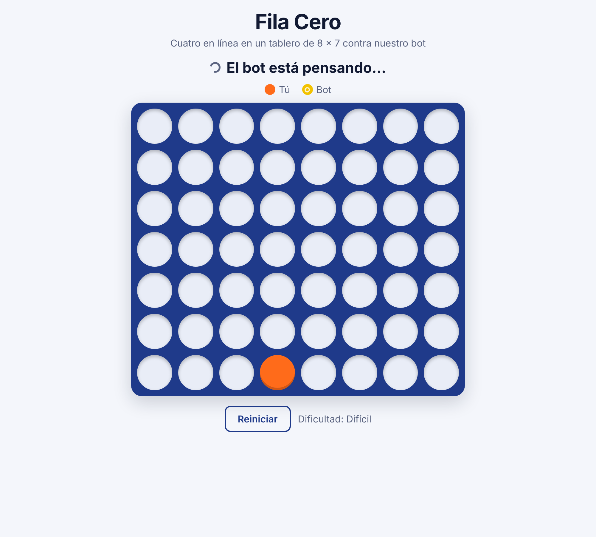
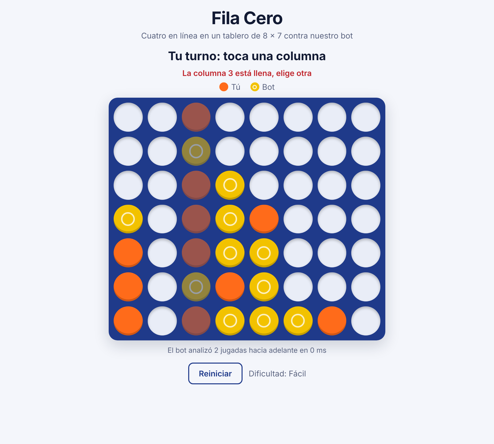
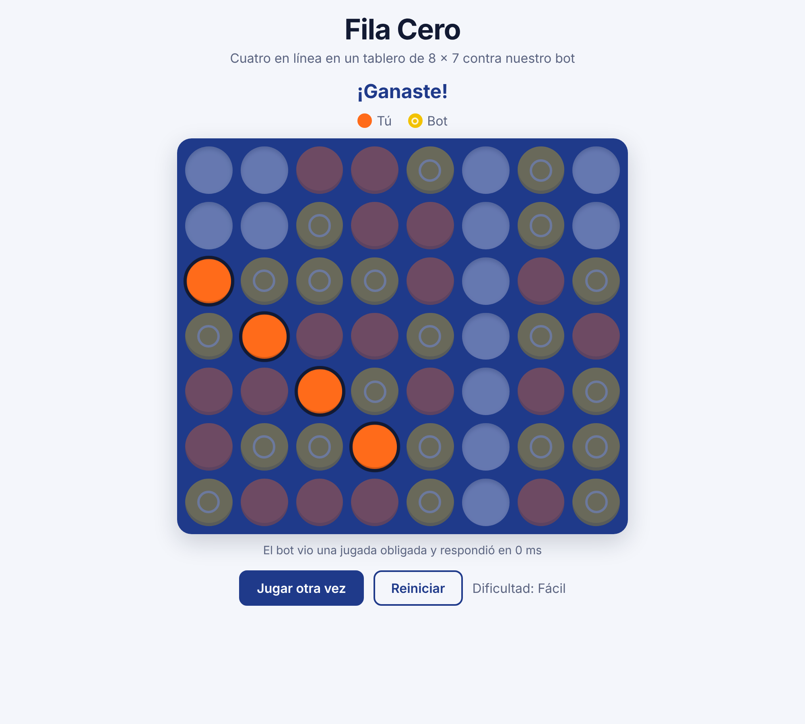
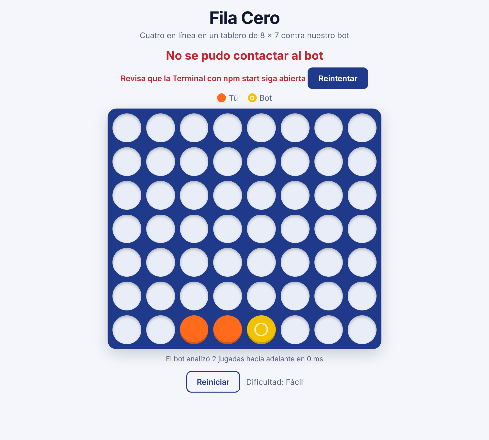

# Manual de usuario

**Fila Cero** es una página web para jugar **Cuatro en línea** contra un programa (el "bot") que hizo nuestro equipo. Se juega en un tablero un poco más grande que el clásico: **8 columnas y 7 filas**.

## Cómo se juega

El objetivo es formar una línea de **cuatro fichas tuyas seguidas** antes que el bot.

1. El tablero tiene 8 columnas y 7 filas, y empieza vacío.
2. En tu turno, **toca una columna**, en cualquier parte. Tu ficha cae hasta el espacio libre más bajo de esa columna, como si la soltaras desde arriba. No se puede elegir la fila: solo la columna.
3. Después juega el bot, que deja caer su ficha en la columna que elige. Se turnan así hasta que termina la partida.
4. **Gana** el primero que forma cuatro fichas propias seguidas: en horizontal (—), en vertical (|) o en diagonal (/ o \).
5. Si se llenan las 56 casillas y nadie formó una línea, es **empate**.

Tus fichas son las del color que dice **"Tú"** en la leyenda, justo arriba del tablero.

**Consejos para tu primera partida:**

- Empieza en el nivel **Fácil**.
- Mira también las fichas del bot: si tiene tres seguidas y un espacio libre para la cuarta, pon tu ficha en ese espacio para bloquearlo.
- Las columnas del centro sirven para formar más líneas que las de los bordes: suelen ser buenas jugadas.

## Abrir la aplicación

La aplicación **no está en internet**: no hay una página a la que entrar desde cualquier lado. Funciona dentro de una computadora, que tiene que tenerla abierta mientras juegas. Elige tu caso:

- **Es tu primera vez y no sabes cómo empezar** → [Primera vez: preparar la computadora](#primera-vez-preparar-la-computadora). Lleva unos 10 minutos y se hace una sola vez.
- **Ya la usaste antes en esta computadora** → [Cada vez que quieras jugar](#cada-vez-que-quieras-jugar).
- **Alguien ya la dejó abierta para ti** → [Si ya está abierta](#si-ya-está-abierta).
- **Quieres jugar desde un teléfono** → [Desde un teléfono](#desde-un-teléfono). Necesitas una computadora que ya tenga la aplicación abierta.

### Primera vez: preparar la computadora

1. Instala **Node.js**, el programa que hace funcionar la aplicación:
   - Entra a https://nodejs.org y pulsa el botón verde **Get Node.js®**.
   - Se abre la página **Download Node.js®**. Arriba aparece un recuadro negro con instrucciones en código: **ignóralo**, es para programadores.
   - Baja hasta la línea que empieza con **"Or get a prebuilt Node.js® for"**. La página ya reconoce tu computadora, así que no cambies nada de esa línea.
   - Pulsa el botón verde **macOS Installer (.pkg)** si usas Mac. En Windows, el botón equivalente es el que termina en **(.msi)**.
   - Abre tu carpeta de **Descargas** (en Mac, desde el Finder; en Windows, desde el Explorador de archivos) y haz **doble clic** en el archivo que acabas de descargar. Su nombre empieza con **node-** y termina en **.pkg** (o **.msi** en Windows).
   - Se abre la ventana **Instalar Node.js**. A la izquierda muestra las etapas; en Mac se avanza así:
     - **Introducción**: dice qué se va a instalar (en inglés, no hace falta entenderlo). Pulsa **Continuar**.
     - **Licencia**: pulsa **Continuar** y, en el aviso que aparece, **Aceptar**.
     - **Selección de destino**: si aparece, pulsa **Continuar** sin cambiar nada.
     - **Tipo de instalación**: pulsa **Instalar**. Te pide la contraseña de tu computadora (la misma con la que la desbloqueas); escríbela y pulsa **Instalar software**.
     - **Instalación**: espera a que se complete la barra, menos de un minuto.
     - **Resumen**: arriba dice **"La instalación se completó correctamente."** Abajo aparece una frase en inglés que menciona `$PATH`: **ignórala**, en Mac no hace falta hacer nada. Pulsa **Cerrar**. Si pregunta qué hacer con el instalador, puedes elegir **Trasladar a la Papelera**: ya no hace falta.
   - En Windows el instalador es parecido: avanza con **Next** (Siguiente), acepta la licencia, deja todas las opciones como están y termina con **Install** y **Finish**.
2. Descarga el proyecto:
   - En https://github.com/JonathanL1ma/fila-cero, pulsa el botón verde **Code** y luego **Download ZIP**.
   - Abre tu carpeta de **Descargas** y haz **doble clic** en el archivo **fila-cero-main.zip**. Se crea al lado una carpeta llamada **fila-cero-main**: esa es la carpeta del proyecto.
3. Abre la **Terminal**, una ventana donde se escriben instrucciones para la computadora. En Mac, búscala con ⌘ + espacio escribiendo "Terminal"; en Windows, busca "Símbolo del sistema".
4. Escribe `cd ` (con un espacio al final). Después arrastra la carpeta **fila-cero-main** desde Descargas hasta la ventana de la Terminal (la carpeta, no el archivo .zip) y pulsa Enter. Así la Terminal queda "dentro" de la carpeta del proyecto.
5. Escribe `npm install` y pulsa Enter. Espera a que termine: puede tardar unos minutos (en nuestra prueba, 3). Termina cuando aparece una línea que empieza con **added** (por ejemplo, "added 178 packages") y la Terminal vuelve a quedar lista para escribir.
   - Debajo pueden aparecer más mensajes: sobre "funding", "found 0 vulnerabilities", líneas que empiezan con **npm warn** (en amarillo) o **npm notice** (por ejemplo, que hay una versión nueva de npm). **No son errores y no hace falta hacer nada**: no escribas los comandos que sugieren.
   - Un error de verdad dice **npm error**, en rojo. Si ves eso, revisa la sección [Si algo falla](#si-algo-falla).
6. Sigue con [Cada vez que quieras jugar](#cada-vez-que-quieras-jugar), desde el paso 3: la Terminal ya está dentro de la carpeta.

### Cada vez que quieras jugar

1. Abre la **Terminal**.
2. Escribe `cd ` (con un espacio al final), arrastra la carpeta **fila-cero-main** a la ventana y pulsa Enter.
3. Escribe `npm start` y pulsa Enter. Van a aparecer varias líneas mientras se prepara la aplicación: espera, tarda unos segundos. Entre ellas pueden aparecer ".env not found. Continuing without it." y "commit desconocido": son normales, no hace falta hacer nada.
4. Cuando aparezca el mensaje **"App y API en http://localhost:3001"**, abre el navegador (Chrome, Safari, Edge o Firefox) y entra a **http://localhost:3001**. Esa es la dirección de la aplicación **en esa misma computadora**. "localhost" significa "este mismo aparato": si la abres en un teléfono, el teléfono la busca en sí mismo y no la encuentra. Para jugar desde un teléfono, ve a [Desde un teléfono](#desde-un-teléfono).
5. Deja la Terminal abierta mientras juegas. Para cerrar la aplicación, vuelve a la Terminal y pulsa Ctrl + C.

### Si ya está abierta

Si otra persona ya tiene la aplicación funcionando, solo necesitas que te diga la dirección. En esa misma computadora es **http://localhost:3001**. Desde un teléfono es algo como **http://192.168.1.25:3001** (ver [Desde un teléfono](#desde-un-teléfono)). Ábrela en el navegador y salta a [La pantalla](#la-pantalla).

### Desde un teléfono

El teléfono no instala nada: solo muestra la aplicación que está abierta en una computadora. Por eso hacen falta dos cosas:

- **Una computadora con la aplicación abierta**, siguiendo [Cada vez que quieras jugar](#cada-vez-que-quieras-jugar). Puede ser la tuya o la de otra persona.
- **El teléfono conectado al mismo Wi-Fi que esa computadora.** Con datos móviles o con otra red no funciona.

**En la computadora**, quien tiene la aplicación abierta:

1. Deja abierta la Terminal donde corre la aplicación. Esa ventana está ocupada y no responde a lo que escribas.
2. Averigua la **dirección IP** de la computadora, su número dentro de la red Wi-Fi:
   - En Mac, la forma más rápida: con la Terminal al frente, pulsa **⌘ + N** para abrir una **ventana nueva**, escribe `ipconfig getifaddr en0` y pulsa Enter. Aparece un número como `192.168.11.237`.
   - En Mac, otra forma: Ajustes del Sistema → Wi-Fi → **Detalles** junto a la red conectada → "Dirección IP".
   - En Windows: abre un Símbolo del sistema nuevo, escribe `ipconfig` y busca "Dirección IPv4".
3. Arma la dirección para el teléfono: `http://` + la IP + `:3001`. Con el ejemplo de arriba, **http://192.168.11.237:3001**. Pásasela a quien va a jugar.
4. Si la computadora pregunta si quieres permitir que "node" acepte conexiones entrantes, pulsa **Permitir**.

**En el teléfono:**

1. Conéctate al **mismo Wi-Fi** que la computadora.
2. Abre el navegador (Chrome o Safari) y escribe la dirección completa, con `http://` al principio y `:3001` al final. **No uses `localhost`**: en el teléfono significa "este mismo teléfono" y no funciona.
3. Junto a la dirección puede aparecer un triángulo o el aviso "No seguro". Es normal: la aplicación está en tu red local, no en internet.
4. Mientras juegas, la computadora tiene que seguir encendida, con la Terminal abierta y sin suspenderse. Si se cierra, el teléfono muestra "No se pudo contactar al bot".

**Si no carga en el teléfono:**

- Revisa que el teléfono y la computadora estén en el mismo Wi-Fi y que la dirección esté escrita exacta.
- El firewall de la computadora puede estar bloqueando la conexión: en Mac, Ajustes del Sistema → Red → Firewall, y permite las conexiones entrantes a "node".
- Algunas redes de oficina o públicas no dejan que los aparatos se comuniquen entre sí. En ese caso, prueba con otra red, por ejemplo la de tu casa.

## La pantalla

*Así se ve la aplicación al abrirla. Si tu computadora usa el modo oscuro, la verás con fondo oscuro en vez de claro: es la misma aplicación y funciona igual.*

De arriba hacia abajo:

1. **Título** "Fila Cero".
2. **Panel de inicio** (solo antes de empezar): eliges quién empieza y la dificultad.
3. **Mensaje de estado**: dice de quién es el turno o cómo terminó la partida.
4. **Leyenda**: qué color de ficha es tuyo ("Tú") y cuál es del bot ("Bot"). Las fichas del jugador 2 tienen además un anillo blanco, para distinguirlas sin depender del color.
5. **Tablero**: 8 columnas y 7 filas.
6. **Botones** "Reiniciar" y, al terminar, "Jugar otra vez".

## Empezar una partida

1. En **¿Quién empieza?**, elige **Yo** o **El bot**. Quien empieza juega con las fichas naranjas.
2. En **Dificultad**, elige el nivel. La aplicación viene con **Medio** marcado; si es tu primera partida, cambia a **Fácil**:
   - **Fácil**: el bot piensa solo un par de jugadas hacia adelante.
   - **Medio**: piensa unas seis jugadas.
   - **Difícil**: piensa todo lo que puede en menos de 2 segundos. Es el mismo nivel con el que juega en el torneo.
3. Pulsa **Jugar**.

## Durante la partida

| Lo que ves | Qué significa | Qué hacer |
|---|---|---|
| **"Tu turno: toca una columna"** | Te toca jugar | Toca o haz clic en cualquier parte de una columna. En una computadora, al pasar el mouse por encima se ve dónde caería la ficha |
| **"El bot está pensando…"** con un círculo girando | El bot está eligiendo su jugada; el tablero no responde | Espera, tarda menos de 2 segundos |
| Una columna **más apagada** que las demás | Esa columna está llena | Elige otra |
| **"La columna X está llena, elige otra"** en rojo | Intentaste jugar en una columna llena | Toca otra columna; el aviso desaparece solo |
| **"El bot analizó N jugadas hacia adelante en M ms"** | Cuánto pensó el bot en su última jugada | Nada, es informativo |

*Es tu turno. Con el mouse sobre la quinta columna, se ve en gris claro dónde caería tu ficha.*

*El bot está pensando su jugada. Mientras tanto, el tablero no responde.*

*La columna 3 está llena: se ve más apagada que las demás y, si la tocas, aparece el aviso en rojo.*

También se puede jugar con el teclado: **Tab** para llegar al tablero, **flechas izquierda y derecha** para elegir la columna y **Enter** para soltar la ficha.

## Fin de la partida

| Mensaje | Significado |
|---|---|
| **"¡Ganaste!"** | Formaste cuatro en línea |
| **"Ganó el bot"** | El bot formó cuatro en línea |
| **"Empate: el tablero se llenó"** | Se llenaron las 56 casillas sin ganador |

Cuando alguien gana, las fichas de la línea ganadora brillan y el resto del tablero se oscurece.

*Ganaste: las cuatro fichas de la línea ganadora quedan resaltadas.*

- **Jugar otra vez** empieza una partida nueva con las mismas opciones.
- **Reiniciar** vuelve al panel de inicio para cambiar quién empieza o la dificultad.

## Si algo falla

| Problema | Solución |
|---|---|
| **"No se pudo contactar al bot"** con un botón **Reintentar** | La partida no se pierde. Revisa que la Terminal con `npm start` siga abierta y pulsa **Reintentar** |
| La página no carga | Revisa que la Terminal muestre "App y API en http://localhost:3001" y que la dirección del navegador termine en `:3001` |
| No carga en el teléfono | Revisa que el teléfono esté en la misma red Wi-Fi y el firewall (sección [Desde un teléfono](#desde-un-teléfono)) |
| La Terminal dice "command not found: npm" | Falta instalar Node.js (paso 1 de [Primera vez: preparar la computadora](#primera-vez-preparar-la-computadora)) |

*El bot dejó de responder. La partida no se pierde: revisa la Terminal y pulsa Reintentar.*
